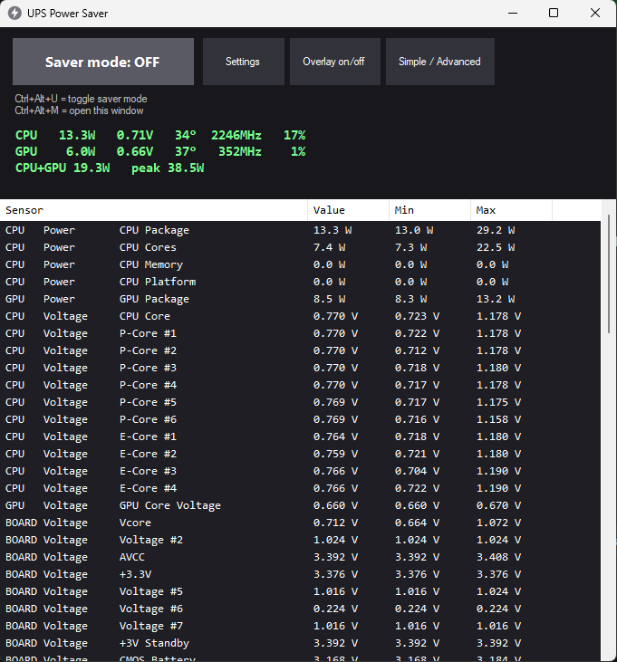
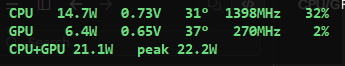

# UPS Power Saver

**One-key power saving for Windows PCs that run on a UPS.** Press a shortcut during a power cut to cap your CPU and GPU
power and stretch your UPS battery time. Press it again when the electricity is back to return to normal. A tiny
on-screen overlay shows live CPU and GPU power draw, and a stats window shows voltages, temperatures and clocks (a
simpler MSI Afterburner-style monitor).




## Features

- **Toggle saver mode with a global shortcut** (default `Ctrl+Alt+U`, changeable in Settings).
  - **CPU:** switches to a dedicated "UPS Saver" Windows power plan with a lower max processor state (default 40 %), Turbo Boost off, and
    energy-saving preference. Your previous plan is restored when you toggle off.
  - **GPU (NVIDIA):** uses `nvidia-smi` to lock the GPU clock range and set the lowest allowed power limit.
  - **Screen:** turns the monitor off sooner when idle.
- **Live power overlay** while saver mode is on: *Simple* (total CPU+GPU watts only) or *Advanced* (watts, volts,
  temperature, clock and load for CPU and GPU, plus the peak since you switched on). Click-through, always on top,
  any screen corner.
- **Stats window** (`Ctrl+Alt+W`): every sensor with current, min and max values: CPU package/core power, Vcore and board voltages, temperatures, clocks, loads.
- **Settings window:** limits, overlay mode/corner/size, and both shortcuts (click the box and press the keys you want).
- **Starts with Windows** (hidden in the tray) so the shortcut is always ready. Can be turned off in Settings.
- Single `.exe`, no installer. Exit from the tray menu restores normal power.

## Install

1. Install the **PawnIO** driver once (needed to read CPU watts and board voltages):
   ```
   winget install --id namazso.PawnIO
   ```
   A restart may be needed. Without it the app still works, but CPU watts and voltages show `0`/`--`.
2. Download `UPS-Power-Saver-vX.Y.Z.zip` from the [Releases](../../releases) page, unzip it somewhere permanent
   (for example `C:\Program Files\UPS Power Saver\`; the auto-start entry points to where the exe lives), and run
   `UPS Power Saver.exe`. Accept the administrator prompt (needed to change GPU limits and read sensors).

## Use

| Action | How |
|---|---|
| Toggle saver mode | `Ctrl+Alt+U` (or the big button in the window, or tray menu) |
| Open the stats window | `Ctrl+Alt+W` or double-click the tray icon |
| Switch overlay Simple/Advanced | button in the window or tray menu |
| Change limits/shortcuts | **Settings** in the window or tray menu |
| Quit (restores normal power) | **Exit app** button, or tray icon → **Exit** |

Closing the window with X only hides it to the tray; the shortcuts keep working. If a shortcut is already used by another
program, the window shows a warning and you can pick a different one in Settings.

Settings are stored in `%APPDATA%\UPSPowerSaver\settings.ini`.

## Tips for stretching UPS runtime

- The overlay shows **CPU+GPU** power only. The motherboard, fans, drives and monitor add roughly 30-60 W on top.
- Lower `CPU max speed` and `GPU max clock` in Settings for a bigger saving; the GPU clock cap saves far more than the power limit.
- Unplug anything you don't need from the UPS and avoid heavy workloads during an outage.

## Requirements and limitations

- Windows 10/11, x64, administrator rights (the app asks for them).
- GPU limits need an **NVIDIA** GPU with `nvidia-smi` (Turing or newer for clock locking). The CPU limits use standard Windows power settings and should work with Intel and AMD, but everything was only tested on Intel.
- Tested on Windows 11 with an Intel Core i5-14400F and NVIDIA RTX 5060. Other hardware may differ; please open an issue.
- Exclusive-fullscreen games can hide the overlay (borderless/windowed works).
- This changes power-management settings and locks GPU clocks while ON. It does not overclock or undervolt anything. Use at your own risk.

## Build from source

Needs only Windows PowerShell (the C# compiler ships with Windows).

```powershell
git clone https://github.com/Muntazer2030/ups-power-saver.git
cd ups-power-saver
.\source\Build.ps1 -Package     # downloads LibreHardwareMonitor (hash-checked), builds the exe, makes dist\*.zip
```

## How it works

- Power plan changes use `powercfg` (duplicate of your current plan named "UPS Saver").
- GPU limits use `nvidia-smi -pl` / `-lgc` and are reset with `-rgc` / the GPU's default power limit.
- Sensors come from [LibreHardwareMonitor](https://github.com/LibreHardwareMonitor/LibreHardwareMonitor), embedded in the exe (see
  [THIRD-PARTY-NOTICES.md](THIRD-PARTY-NOTICES.md)).

## License

[MIT](LICENSE). Third-party components keep their own licenses.
